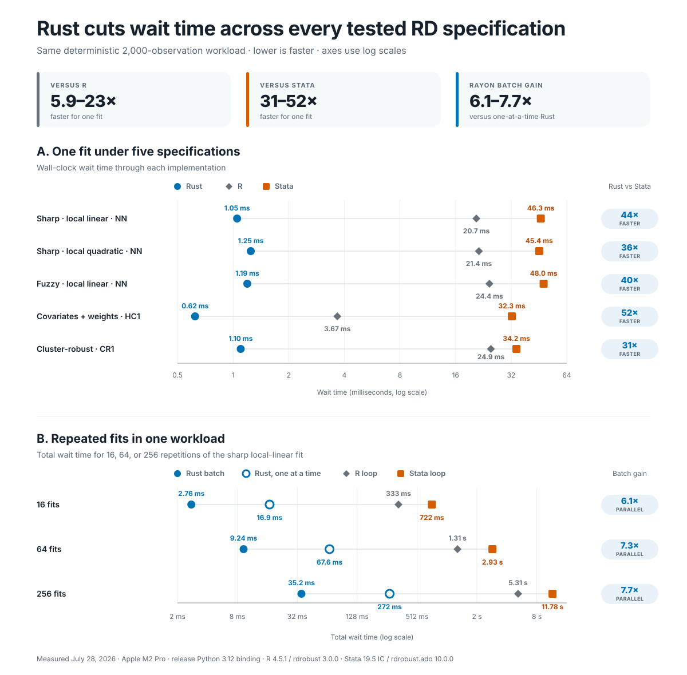
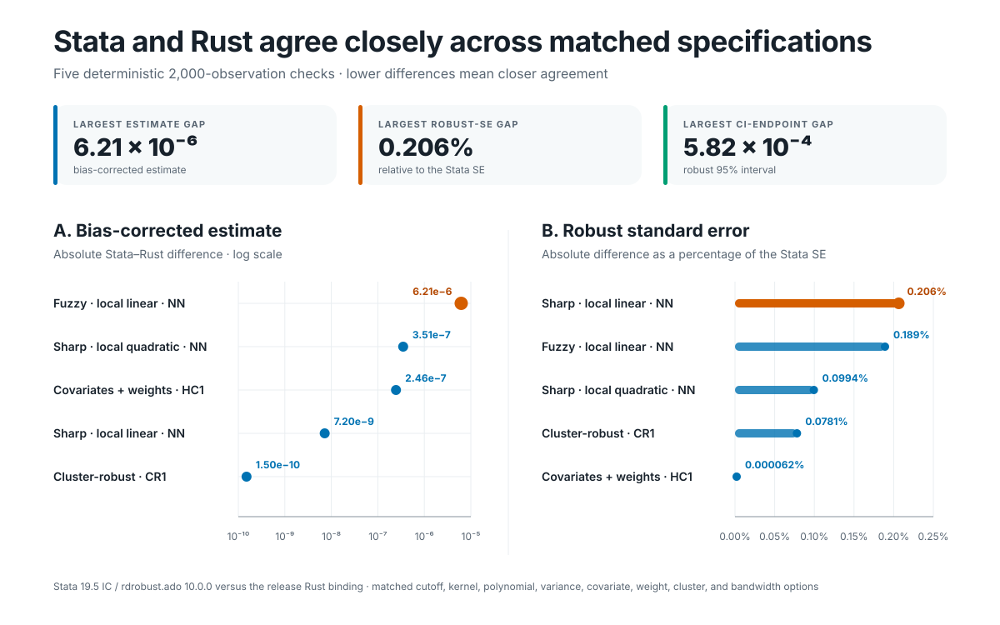

# rdrobust-rust

> Independent Rust reimplementation of
> [rdrobust](https://github.com/rdpackages/rdrobust). This is not an official
> rdpackages release.

`rdrobust-rust` estimates treatment effects in regression-discontinuity (RD)
designs. It combines a compiled Rust numerical core with a Python extension
that accepts NumPy arrays and returns ordinary Python dictionaries. You can
also call the Rust core directly.

The project is built for research workflows that repeat the same RD
calculation across many outcomes, subgroups, simulations, specifications, or
cutoffs.

> **Project status:** This repository is a private source release. The Python
> and Rust packages have not been published to PyPI or crates.io, so install
> them from this repository.

## Results at a glance

For the measured 2,000-observation workload:

- A single Rust fit took 0.62–1.25 milliseconds: 5.9–23× faster than R and
  31–52× faster than Stata.
- Rust's parallel batch path was 6.1–7.7× faster than running the same Rust
  fits one at a time.
- A 256-fit batch took 35.2 milliseconds in Rust, compared with 5.31 seconds
  in R and 11.78 seconds in Stata.
- Across five matched Stata and Rust checks, estimates differed by at most
  `6.21e-6` and robust standard errors by at most 0.206%.



These are wall-clock measurements from one machine and workload, not universal
guarantees. See [Measured performance](#measured-performance) for the benchmark
method and [Numerical parity with Stata](#numerical-parity-with-stata) for the
matched output comparison.

## What an RD estimate does

An RD design applies when a rule assigns or encourages treatment according to
whether an observed score crosses a known threshold. For example, students may
become eligible for a program when an exam score crosses a fixed cutoff. The
score is the **running variable**, and the threshold is the **cutoff**.

RD estimation compares outcomes just below and just above that cutoff. If the
outcome changes discontinuously there, the size of the jump can identify a
local treatment effect under the design's assumptions. This package estimates
that jump with local polynomial regressions.

Terms used throughout this README:

- **Running variable (`x`):** the variable that places each observation above
  or below the cutoff.
- **Outcome (`y`):** the variable whose discontinuity you want to estimate.
- **Cutoff (`c`):** the threshold in the running variable. The default is `0`.
- **Sharp RD:** the treatment rule switches completely at the cutoff.
- **Fuzzy RD:** treatment becomes more or less likely at the cutoff, but not
  everyone follows the assignment rule.
- **Bandwidth:** the window around the cutoff used to fit the local
  regressions.
- **Robust bias-corrected inference:** an estimate that corrects leading
  local-polynomial bias, paired with inference that accounts for the
  correction.

The software computes the estimator; it does not establish that an RD design
supports a causal interpretation. Researchers still need to assess whether
observations near the cutoff are comparable, whether units can manipulate the
running variable, and whether another rule changes at the same cutoff.

## Choose an entry point

|Task|Entry point|
|-|-|
|Estimate one dataset at one cutoff|Python: `rdrobust_rust.rdrobust`|
|Estimate many independent datasets with shared options|Python: `rdrobust_rust.rdrobust_batch`|
|Estimate one dataset at several cutoffs|Python: `rdrobust_rust.rdrobust_multi_cutoff`|
|Compute binned means and polynomial curves for an RD plot|Python: `rdrobust_rust.rdplot`|
|Use the estimator from Rust|The `rdrobust-core` crate in this workspace|

`rdplot` returns the numerical data needed to make a plot. It does not render a
figure.

## Why this implementation exists

The official [rdrobust](https://github.com/rdpackages/rdrobust) packages remain
the default choice for general RD work. This project targets a narrower
computational problem: running many independent RD fits without asking Python
to manage each fit separately.

- The same Rust core powers the single-fit, batch, and multiple-cutoff APIs.
- The batch and multiple-cutoff functions use
  [Rayon](https://docs.rs/rayon/latest/rayon/) to distribute independent fits
  across a shared thread pool.
- The Python extension releases Python's
  [global interpreter lock](https://pyo3.rs/main/parallelism) while Rust is
  computing. Other Python threads can continue while Rayon uses multiple CPU
  cores.
- A batch runs inside one process. This avoids starting a Python interpreter
  for every worker and can reduce some of the serialization and data copying
  associated with
  [`multiprocessing`](https://docs.python.org/3/library/multiprocessing.html).
- Deterministic fixtures compare the numerical results with the upstream R
  package.

Rust does not make every RD call faster or use less memory. A small, single fit
may gain little after Python-to-Rust conversion costs. The implementation also
sorts and owns its working data, so it is not zero-copy. Benchmark the workload
you plan to run before drawing conclusions about speed or memory use.

## Measured performance

In the single-fit benchmark, one call through the Python-to-Rust binding took
0.62–1.25 milliseconds. The matched R call took 3.7–24.9 milliseconds, and the
matched Stata call took 32.3–48.0 milliseconds. For a batch of 256 fits, Rust
finished in 35.2 milliseconds; sequential R and Stata loops took 5.31 and 11.78
seconds.

These are wall-clock wait times. They include the estimator and the conversion
of its result into Python objects, but not process startup, compilation, data
generation, file input, or file output.

### One fit under different specifications

Each fit uses the same deterministic dataset with 2,000 observations.

|Specification|R wait|Stata wait|Rust wait|vs. R|vs. Stata|
|-|-|-|-|-|-|
|Sharp, local linear, NN|20.7 ms|46.3 ms|1.05 ms|20×|44×|
|Sharp, local quadratic, NN|21.4 ms|45.4 ms|1.25 ms|17×|36×|
|Fuzzy, local linear, NN|24.4 ms|48.0 ms|1.19 ms|20×|40×|
|Covariates and weights, HC1|3.67 ms|32.3 ms|0.62 ms|5.9×|52×|
|Cluster-robust, CR1|24.9 ms|34.2 ms|1.10 ms|23×|31×|

Local linear and local quadratic refer to polynomial orders `p=1` and `p=2`.
NN uses nearest-neighbor residuals, HC1 is heteroskedasticity-robust, and CR1
is cluster-robust. The final two columns report how many times faster Rust was;
lower wait times are better.

### Many fits in parallel

The next benchmark repeats the local-linear sharp specification. “Parallel
gain” compares the Rust batch function with the same Rust fits run one at a
time.

|Number of fits|Rust, one at a time|Rust batch|Parallel gain|R loop|Stata loop|
|-|-|-|-|-|-|
|16|16.9 ms|2.8 ms|6.1×|0.33 s|0.72 s|
|64|67.6 ms|9.2 ms|7.3×|1.31 s|2.93 s|
|256|271.5 ms|35.2 ms|7.7×|5.31 s|11.78 s|

Compared with the sequential R loop, the Rust batch was 121–151× faster.
Compared with the sequential Stata loop, it was 262–334× faster. These larger
gains combine faster individual fits with parallel execution inside one
process.

The measurements were taken on July 28, 2026, on an Apple M2 Pro with 12 CPU
cores and 16 GB of memory. Rust used a release build of the Python 3.12
extension and Rayon's 12-thread pool. Stata 19.5 IC used one licensed processor
and `rdrobust.ado` 10.0.0. R 4.5.1 used `rdrobust` 3.0.0 in a sequential loop.

Rust single-fit values are medians from seven groups of 100 calls. Rust batch
values are medians from seven runs. R and Stata single-fit timings use repeated
groups of 30 calls; their batch timings cover the whole loop. The data were
already in memory before each timer started. This is a comparison with
single-process R and sequential Stata IC, not parallel R or Stata/MP. Results
will change with the data, options, software versions, and hardware.

## Numerical parity with Stata

Speed is useful only if the implementations return substantively the same
answer. We therefore ran the five specifications above on the same observations
and matched the cutoff, kernel, polynomial order, variance estimator,
covariates, weights, clustering, and bandwidth options.



The first table compares the bias-corrected treatment-effect estimate. The
second compares the robust standard error used for inference.

### Bias-corrected estimates

|Specification|Stata|Rust|Absolute difference|
|-|-|-|-|
|Sharp, local linear, NN|1.984959557|1.984959550|7.20e-9|
|Sharp, local quadratic, NN|1.975715611|1.975715260|3.51e-7|
|Fuzzy, local linear, NN|1.474635648|1.474641860|6.21e-6|
|Covariates and weights, HC1|1.888369659|1.888369414|2.46e-7|
|Cluster-robust, CR1|1.984375900|1.984375900|1.50e-10|

### Robust standard errors

|Specification|Stata|Rust|Absolute difference|
|-|-|-|-|
|Sharp, local linear, NN|0.092780155|0.092971691|1.92e-4|
|Sharp, local quadratic, NN|0.121844106|0.121965207|1.21e-4|
|Fuzzy, local linear, NN|0.155436887|0.155730756|2.94e-4|
|Covariates and weights, HC1|0.241996150|0.241995999|1.51e-7|
|Cluster-robust, CR1|0.089647609|0.089717619|7.00e-5|

Across these five cases, the largest estimate difference was `6.21e-6`. The
largest robust-standard-error difference was `2.94e-4`, or 0.206% of the Stata
value. The largest difference between corresponding robust confidence-interval
endpoints was `5.82e-4`.

This is close numerical agreement, not bit-for-bit identity. The repository's
automated fixtures use its pinned R reference implementation, while this
separate check uses the current Stata package named above. Small differences
can arise from changes in bandwidth and variance calculations across package
versions. Use matched software versions and explicit tolerances when parity is
a hard requirement.

The Stata comparison is a targeted cross-version check. The broader automated
suite draws on 123 deterministic R-derived fixtures covering bandwidth
selection, estimation, clustering, plotting, preprocessing, and weights. The
individual Rust tests document their tolerances, generally around `1e-8` for
continuous quantities. Run the commands in
[Test the repository](#test-the-repository) to check that suite locally.

## Install the Python extension

The commands below clone the private repository, create an isolated Python
environment, and compile an optimized extension.

### 1. Install the prerequisites

You need:

- access to the private `sankalpsharmaa/rdrobust-rust` repository;
- [GitHub CLI](https://cli.github.com/), authenticated with `gh auth login`;
- [Rust installed through rustup](https://rustup.rs/); and
- [uv](https://docs.astral.sh/uv/getting-started/installation/).

On macOS or Linux, install Rust and uv if needed:

```sh
curl --proto '=https' --tlsv1.2 -sSf https://sh.rustup.rs | sh
curl -LsSf https://astral.sh/uv/install.sh | sh
```

Open a new shell, then check that each command is available:

```sh
rustc --version
uv --version
gh auth status
```

### 2. Clone the repository

```sh
gh repo clone sankalpsharmaa/rdrobust-rust
cd rdrobust-rust
```

### 3. Create a Python environment

CI tests Python 3.9 through 3.14. Python 3.12 is a conservative default:

```sh
uv venv --python 3.12
source .venv/bin/activate
uv pip install numpy
```

On Windows PowerShell, activate the environment with:

```powershell
.venv\Scripts\Activate.ps1
```

### 4. Build and install the extension

[`maturin develop`](https://www.maturin.rs/local_development) compiles the Rust
extension and installs it in the active Python environment:

```sh
env -u CONDA_PREFIX uvx maturin develop \
  --release \
  --manifest-path rdrobust-py/Cargo.toml
```

The `env -u CONDA_PREFIX` prefix prevents an active Conda base environment from
competing with `.venv`. It does nothing when Conda is inactive.

On Windows PowerShell, clear that variable once and run the build command
without the `env -u CONDA_PREFIX` prefix:

```powershell
Remove-Item Env:CONDA_PREFIX -ErrorAction SilentlyContinue
uvx maturin develop --release --manifest-path rdrobust-py/Cargo.toml
```

### 5. Check the installation

```sh
python -c 'import rdrobust_rust as rr; print(rr.__name__)'
```

Expected output:

```text
rdrobust_rust
```

## Estimate one cutoff in Python

This example creates a synthetic outcome with a jump of `2` at the cutoff
`x = 0`, then estimates that jump:

```python
import numpy as np
import rdrobust_rust as rr

rng = np.random.default_rng(0)
x = np.ascontiguousarray(rng.uniform(-1, 1, 10_000), dtype=np.float64)
y = np.ascontiguousarray(
    0.5 * x + 2.0 * (x >= 0) + rng.standard_normal(x.size),
    dtype=np.float64,
)

result = rr.rdrobust(y, x, c=0.0)

print("Bias-corrected estimate:", result["coef"][1])
print("Robust 95% CI:", result["ci"][2])
print("Selected bandwidths:", result["bws"])
```

The output rows always follow this order:

1. conventional;
2. bias-corrected; and
3. robust.

The robust row uses the bias-corrected point estimate with the robust standard
error. The result dictionary contains:

|Key|Shape and contents|
|-|-|
|`coef`|Three point estimates in the row order above|
|`se`|Three standard errors in the row order above|
|`z`|Three test statistics|
|`pv`|Three two-sided p-values|
|`ci`|Three `[lower, upper]` confidence intervals|
|`bws`|Estimation and bias-correction bandwidths for both sides|

The exact `bws` layout is
`[[h_left, h_right], [b_left, b_right]]`. Here, `h` is the estimation bandwidth
and `b` is the bias-correction bandwidth.

## Estimate many datasets in parallel

Use `rdrobust_batch` when each row is a separate dataset and all fits use the
same options. The `x` and `y` arrays must both have shape
`(number_of_fits, observations_per_fit)`.

```python
import numpy as np
import rdrobust_rust as rr

rng = np.random.default_rng(1)
fits, observations = 100, 5_000

x = np.ascontiguousarray(
    rng.uniform(-1, 1, size=(fits, observations)),
    dtype=np.float64,
)
y = np.ascontiguousarray(
    0.3 * x + 1.5 * (x >= 0) + rng.standard_normal(x.shape),
    dtype=np.float64,
)

results = rr.rdrobust_batch(y, x, c=0.0)
estimates = np.array([result["coef"][1] for result in results])
print(estimates)
```

Rayon uses the machine's logical CPU count by default. Set
`RAYON_NUM_THREADS` before Python starts to cap the shared thread pool:

```sh
RAYON_NUM_THREADS=8 python analysis.py
```

Do not place `rdrobust_batch` inside another multiprocessing pool. Put each fit
in a row and let the batch function parallelize the work once.

## Estimate one dataset at several cutoffs

Use `rdrobust_multi_cutoff` when every fit shares the same outcome and running
variable:

```python
import numpy as np
import rdrobust_rust as rr

rng = np.random.default_rng(2)
x = np.ascontiguousarray(rng.uniform(-1, 1, 10_000), dtype=np.float64)
y = np.ascontiguousarray(
    0.4 * x + 1.0 * (x >= 0) + rng.standard_normal(x.size),
    dtype=np.float64,
)
cutoffs = np.array([-0.25, 0.0, 0.25], dtype=np.float64)

results = rr.rdrobust_multi_cutoff(y, x, cutoffs)

for cutoff, result in zip(cutoffs, results):
    print(cutoff, result["coef"][1], result["ci"][2])
```

Here, `x` and `y` are one-dimensional arrays. The function evaluates the
cutoffs in parallel and returns one result dictionary per cutoff, in the same
order as the input array.

## Prepare Python inputs

The binding expects dense, finite NumPy arrays:

1. Convert numerical inputs to `np.float64`.
2. Make them C-contiguous with `np.ascontiguousarray`.
3. Give `x` and `y` the same number of observations.
4. Include observations on both sides of every cutoff.
5. Remove `NaN` and infinite values before estimation.
6. Give `fuzzy`, `cluster`, and `weights` the same length as `x`.
7. Use nonnegative observation weights.
8. Give `covs` shape `(observations, covariates)` for one fit or
   `(fits, observations, covariates)` for a batch.
9. For a batch, give `fuzzy`, `cluster`, and `weights` the same two-dimensional
   shape as `x` and `y`.
10. Encode cluster labels as finite numbers.

`np.ascontiguousarray` ensures that values are stored in the row-major memory
layout expected by the binding. The running variable does not need to be
sorted; the binding sorts each dataset internally. Invalid inputs raise
`ValueError`.

## Supported features

- Sharp and fuzzy RD estimation with robust bias-corrected inference.
- Data-driven bandwidth selection.
- Covariates and observation weights.
- Nearest-neighbor, heteroskedasticity-consistent, and cluster-robust variance
  estimators.
- Binned means and polynomial fit data through `rdplot`.
- Parallel batch and multiple-cutoff estimation.

## Current limitations

The public output focuses on estimates, standard errors, tests, confidence
intervals, and bandwidths. It does not expose per-side decompositions, fuzzy
first-stage diagnostics, multi-row `rdbwselect(all=TRUE)` output, or several
`rdplot` extensions.

The Python binding accepts NumPy arrays, not pandas DataFrames. It also has no
`subset` argument or automatic missing-value handling. Prepare those inputs in
Python before calling the extension.

## Use the Rust core directly

The `rdrobust-core` crate contains the numerical API. Run the included examples
from the repository root:

```sh
cargo run --release -p rdrobust-core --example sharp_rd
cargo run --release -p rdrobust-core --example monte_carlo
```

The first command runs one sharp RD estimate. The second runs a parallel
Monte Carlo workload with 256 independent fits.

## Benchmark your workload

Run the native benchmark suite from the repository root:

```sh
cargo bench -p rdrobust-core --bench rdrobust_bench
```

It measures single-fit latency at several sample sizes, different variance
estimators, sharp and fuzzy designs, serial batches, parallel batches, and
multiple cutoffs.

For the existing end-to-end Rust and R comparison, run:

```sh
python3 tools/parity.py benchmark
```

That command starts a fresh R process during timing, so its absolute values are
not directly comparable with the in-process Stata measurements above. Treat
each result as an engineering measurement for that machine and dataset, not as
a general performance claim. Record the array sizes, number of fits, CPU count,
Rayon thread count, software versions, and peak memory when comparing
implementations.

Regenerate the two README figures after changing the measured values:

```sh
node tools/generate_readme_figures.mjs
```

The generator has no third-party JavaScript dependencies and writes
deterministic SVG files to `docs/assets/`.

## Repository layout

|Path|Purpose|
|-|-|
|`docs/assets/`|Generated SVG figures used in this README|
|`rdrobust-core/`|Pure-Rust numerical crate|
|`rdrobust-py/`|PyO3 and maturin Python extension|
|`fixtures/`|Deterministic, schema-versioned fixtures generated from R|
|`tools/`|Fixture, parity, benchmark, and README-figure tools|

## Test the repository

Run the standard checks from the repository root:

```sh
cargo fmt --all -- --check
cargo clippy --workspace --all-targets --all-features -- -D warnings
cargo test --workspace --all-targets --all-features
RUSTDOCFLAGS="-D warnings" cargo doc --workspace --all-features --no-deps
python3 -m unittest tools.parity
python3 tools/parity.py verify
python rdrobust-py/tests/test_bindings.py
```

The final Python command requires the extension to be installed in the active
environment.

### Regenerate the R parity fixtures

Most contributors do not need to regenerate fixtures. Do this only when a
numerical change requires new reference output.

Fixture generation requires `Rscript`, `jsonlite`, and the upstream R package
pinned to the 4.1.0 source revision used by this repository. Install them in an
isolated R library:

```sh
mkdir -p .r-lib
R_LIBS_USER="$PWD/.r-lib" Rscript -e \
  'install.packages(c("jsonlite", "remotes"), repos="https://cloud.r-project.org");
   remotes::install_github("rdpackages/rdrobust",
     ref="a86d11aa5a89f28923c9b1ed4b8ba5c0d83d4514",
     subdir="R/rdrobust", dependencies=FALSE, upgrade="never")'
R_LIBS_USER="$PWD/.r-lib" Rscript -e \
  'stopifnot(packageVersion("rdrobust") == "4.1.0")'
R_LIBS_USER="$PWD/.r-lib" python3 tools/parity.py generate --check
```

See [RELEASING.md](RELEASING.md) for packaging, publication, and clean-install
checks.

## License and attribution

This project is distributed under GPL-3.0-only. See [LICENSE](LICENSE),
[NOTICE](NOTICE), and [AUTHORS](AUTHORS).

The original rdrobust authors are Sebastian Calonico, Matias D. Cattaneo,
Max H. Farrell, and Rocio Titiunik.

## Security

Report suspected vulnerabilities privately through this repository's GitHub
Security Advisories interface rather than opening a public issue.
